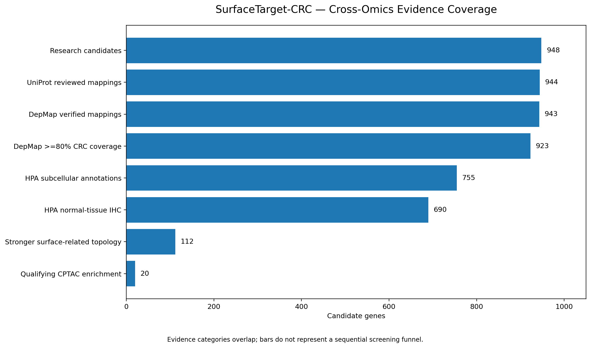
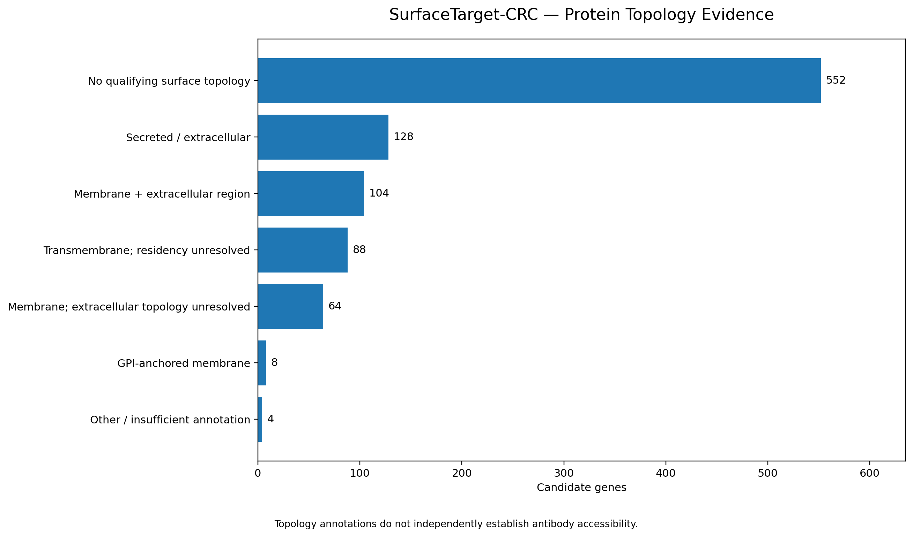
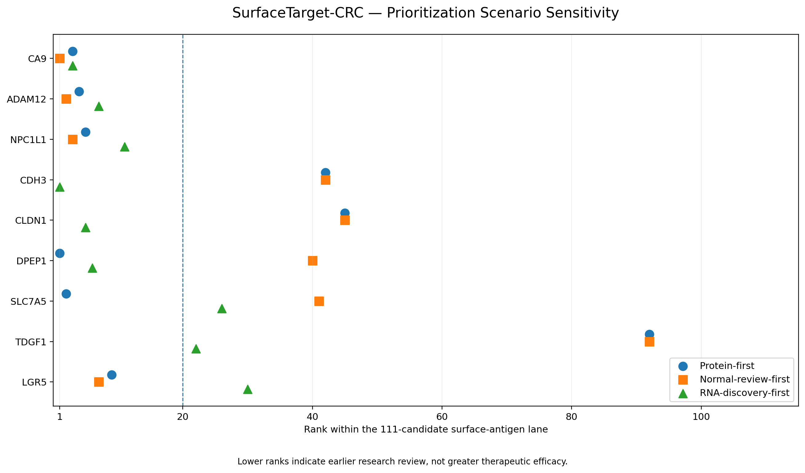

# SurfaceTarget-CRC

## Multi-Omics Prioritization of Colorectal Cancer
## Cell-Surface and Microenvironment Target Hypotheses

SurfaceTarget-CRC is an exploratory computational biology
research project integrating transcriptomics, proteomics,
protein localization, normal-tissue annotations, and
CRISPR functional-genomics evidence.

The project develops evidence-supported research hypotheses
for experimental investigation. It does not claim
clinically validated therapeutic targets.

## Research data sources

- TCGA/GDC colorectal transcriptomics
- CPTAC paired MSS colon cancer proteomics
- Human Protein Atlas (HPA)
- UniProt reviewed protein annotations
- DepMap Public 26Q3 CRISPR gene-effect data
- HGNC gene identifier mappings

## Main findings

| Research component | Result |
|---|---:|
| Original research candidates | 948 |
| Qualifying CPTAC-enriched genes | 20 |
| Stronger surface-related topology annotations | 112 |
| Verified DepMap mappings | 943 |
| Putative cell-surface review candidates | 111 |
| Detailed research panel | 15 |

CA9, ADAM12, and NPC1L1 appeared in the
top 20 under all three research-prioritization scenarios.

However, the protein-first and normal-review-first
rankings were highly correlated (Spearman rho = 0.986).

Ranking consistency is not independent
experimental validation.

## Research figures

### Figure 1: Cross-omics evidence coverage

### Figure 2: Protein topology

### Figure 3: Ranking sensitivity

## Fifteen-gene research panel

**Cross-scenario surface hypotheses**

CA9, ADAM12, NPC1L1

**Additional surface-antigen hypotheses**

CDH3, CLDN1, DPEP1, SLC7A5, TDGF1, LGR5

**Stromal-targeting hypothesis**

FAP

**Membrane-accessibility investigations**

SLC5A6, CEMIP

**Extracellular microenvironment hypotheses**

CTHRC1, MXRA5, SFRP4

The groups describe different biological mechanisms.
They are not a single therapeutic ranking.

## Research documentation

[Formal scientific report](reports/SurfaceTarget_CRC_Formal_Research_Report_Draft_v1.md)

[Experimental validation roadmap](results/tables/surfacetarget_phase5_experimental_validation_roadmap.csv)

[Data access documentation](docs/DATA_ACCESS.md)

## Repository structure

- reports/ : Research interpretation and scientific report
- results/figures/ : Research visualizations
- results/tables/ : Selected derived analysis outputs
- data/metadata/ : Selected provenance files
- src/ : Available analysis scripts
- notebooks/ : Jupyter notebooks after manual review
- docs/ : Data access and reproducibility information

## Reproducibility

This repository contains a documented computational
research analysis and selected derived outputs.

The complete executed Colab notebook should be
added to notebooks/ after reviewing its contents.

Raw TCGA, CPTAC, and DepMap data are not
redistributed in this repository.

See docs/DATA_ACCESS.md for source information.

The report remains a technical draft. Full
independent reproducibility and publication readiness
require verification of earlier cohort methods,
dataset accessions, software versions, and citations.

## Limitations

- TCGA discovery cases are not uniformly MSS-confirmed.
- DepMap colorectal cell lines are not all MSS-confirmed.
- Bulk expression does not establish malignant-cell origin.
- Protein topology does not prove antibody accessibility.
- HPA normal-tissue staining does not establish safety.
- CRISPR dependency does not directly establish ADC efficacy.
- No new experimental validation was performed.

## Status

Exploratory computational research.

The findings represent target hypotheses,
not clinically validated therapeutic recommendations.
