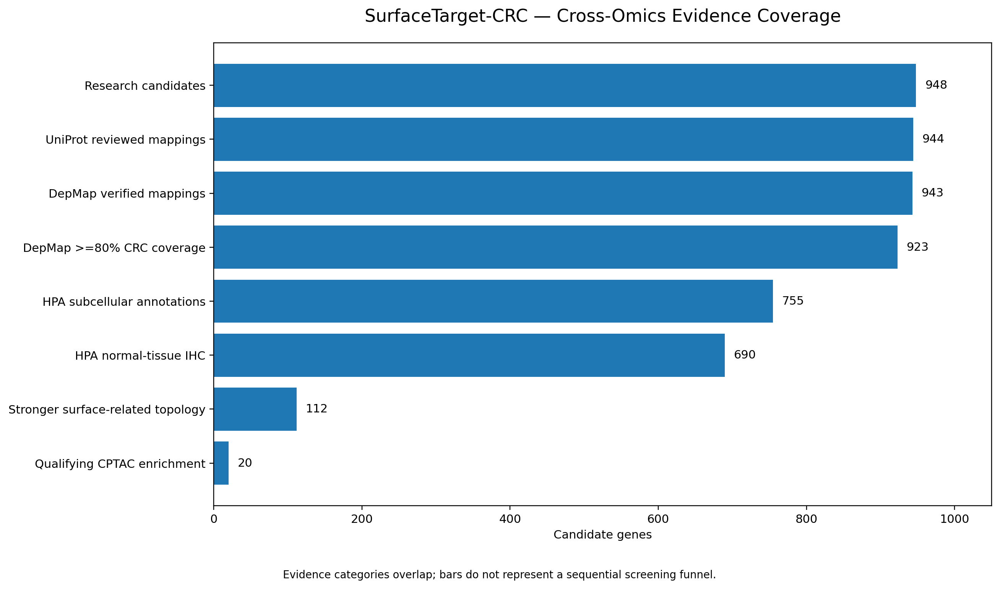
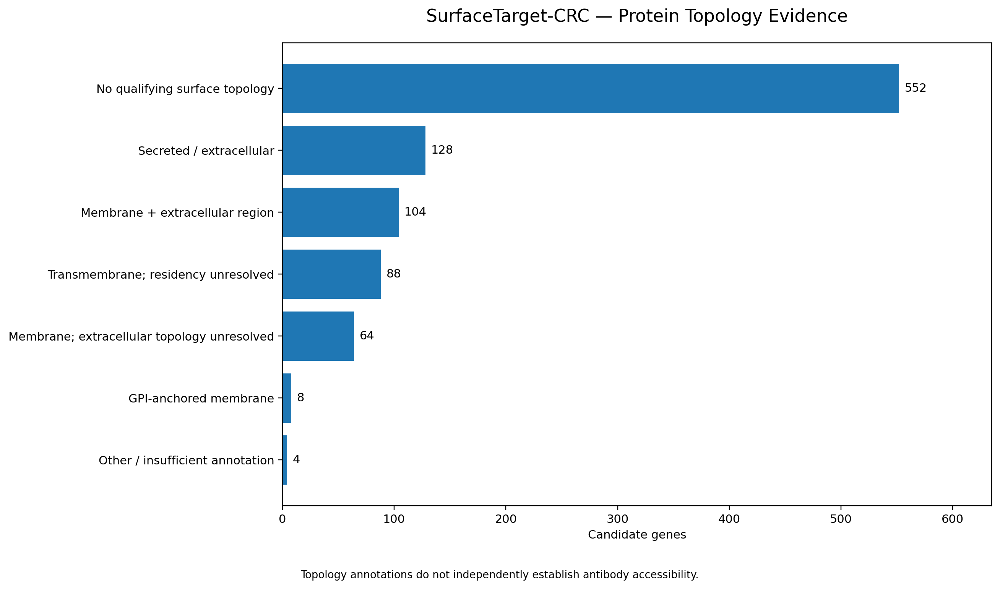
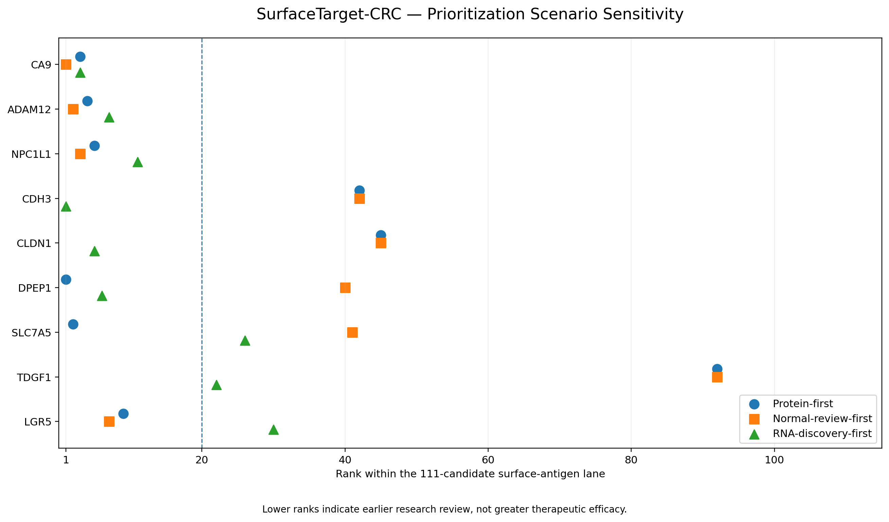

# SurfaceTarget-CRC
## Multi-omics prioritization of colorectal cancer cell-surface and microenvironment target hypotheses

**Technical research report — evidence-grounded draft (Phase 6.2)**

Generated: 2026-11-21 09:15 UTC

> **Research-use only.** This is a computational target-hypothesis analysis. No candidate has been experimentally validated for antibody binding, therapeutic efficacy, or clinical safety.

## Abstract

Identifying potentially accessible tumor-associated targets requires more than differential RNA expression. SurfaceTarget-CRC integrates exploratory TCGA colorectal transcriptomic evidence, paired MSS colon proteomics from CPTAC, protein topology and normal-tissue observations from UniProt/HPA, and colorectal cell-line knockout fitness from DepMap. A total of **948 gene-level candidates** were retained from the transcriptomic workflow. Among them, **20** met the project’s qualifying paired-protein enrichment criteria, **112** had stronger surface-related topology annotations, and **943** were represented in the validated DepMap gene-effect mapping. Three deliberately different within-lane review scenarios were compared for **111 putative cell-surface candidates**. **CA9, ADAM12, and NPC1L1** occurred in all three top-20 lists, although the protein-first and normal-review-first rankings were strongly correlated (Spearman ρ = 0.986). The output is an explicitly selected, mechanism-stratified **15-gene research panel**, not an optimized or clinically validated target ranking.

## 1. Background and objective

Tumor/normal differential expression can identify research leads but does not establish plasma-membrane residency, extracellular epitope availability, malignant-cell specificity, favorable normal-tissue distribution, or drug-response effects. This project asks which colorectal tumor-associated genes warrant follow-up as potential cell-surface, stromal, or extracellular-microenvironment targeting hypotheses. It prioritizes auditability, class-specific interpretation, source-specific missingness, and explicit experimental validation needs.

## 2. Datasets and methods

### 2.1. Discovery transcriptomics — TCGA/GDC

An earlier workflow performed colorectal tumor-versus-normal transcriptomic analyses, QC sensitivity checks, supporting expression review, and patient-paired directional assessment. The retained set contains **948** candidate genes. The discovery workflow included a **computationally low-MSI** subgroup that must **not** be described as independently confirmed microsatellite-stable (MSS). The same-study sensitivity analyses and matched-patient direction checks are supporting analyses, not independent external validation. For downstream descriptive ranking, a conservative effect-size field was defined as the minimum of baseline and QC sensitivity log2 fold changes.

### 2.2. Paired protein evidence — CPTAC

The paired MSS colon tumor/normal proteomics analysis used a within-patient Wilcoxon signed-rank framework and multiple-testing adjustment. Candidate-level interpretation distinguishes qualifying enrichment, adequately covered nonqualifying measurements, sparse paired observations, and unavailable coverage. **20/948** candidates met the project-defined enrichment requirements. Unavailable or sparse protein measurements were **not** interpreted as protein absence. The detailed paired-sample inclusion and significance settings remain in the earlier phase outputs.

### 2.3. Localization and normal-tissue annotation — UniProt/HPA

Reviewed UniProt annotation, membrane/extracellular topology, GPI anchoring, HPA subcellular localization, and normal-tissue IHC were preserved as distinct evidence dimensions. Seven mutually exclusive annotation classes were defined from extracted topology fields. HPA tissue-level IHC is descriptive; an unmeasured gene is not assigned zero normal-tissue staining. Tissue-level maxima do not resolve all cell types and are not quantitative clinical toxicity predictions.

### 2.4. CRISPR functional context — DepMap 26Q3

Ensembl-to-DepMap gene identity was validated through HGNC-approved Ensembl/NCBI Gene ID crosswalks. **943/948** candidates matched DepMap gene-effect columns; **923** were measured in at least **65 of 81** colorectal adenocarcinoma models. A **79-model** patient-deduplicated sensitivity cohort and a **1,260-model** heterogeneous non-bowel comparator were evaluated in Phase 4. No MSS status was inferred for the DepMap colorectal models. CRISPR knockout fitness is not a proxy for antibody binding, epitope accessibility, or antibody-drug conjugate efficacy.

### 2.5. Biological lanes and ranking-sensitivity design

Genes were divided into putative surface-antigen, stromal, membrane-accessibility, extracellular microenvironment, and alternative/topology-clarification follow-up lanes. The **111** putative surface-antigen candidates were ordered in three deterministic scenarios: protein-evidence-first, normal-tissue-review-first, and RNA-discovery-first. Rank comparisons are **within the same lane only**. These are lexicographic research-review rules, not weighted therapeutic-efficacy scores. The two scenarios based primarily on protein and normal-tissue annotation proved highly similar, so two-of-three top-20 agreement should not be treated as independent robustness.

## 3. Results

### 3.1. Evidence coverage among 948 candidates

| Evidence category | Number of candidates |
|---|---:|
| Candidate universe | 948 |
| Reviewed UniProt mappings | 944 |
| Verified DepMap mappings | 943 |
| High-coverage DepMap genes (>=65/81 models) | 923 |
| HPA subcellular annotations | 755 |
| HPA normal-tissue IHC | 690 |
| Stronger surface-related annotation | 112 |
| Qualifying CPTAC enrichment | 20 |

The categories in this table **overlap** and do not represent successive eliminations from a funnel.

*Figure 1. Source-specific coverage among the same 948 research genes. Categories overlap.*

### 3.2. Topology classification

| Extracted topology annotation class | Genes |
|---|---:|
| No qualifying surface-topology evidence in extracted annotations | 552 |
| Secreted/extracellular; membrane attachment not established | 128 |
| Membrane with annotated extracellular region | 104 |
| Transmembrane; surface localization unresolved | 88 |
| Membrane-associated; extracellular topology unresolved | 64 |
| GPI-anchored membrane-associated | 8 |
| Other or insufficient topology annotation | 4 |

The **104** candidates with annotated extracellular membrane regions and **8** GPI-anchored membrane-associated candidates constitute the **112** with stronger surface-related annotations. Topology evidence alone does not demonstrate antibody recognition or cancer-cell localization.

*Figure 2. Seven mutually exclusive annotation classes based on extracted UniProt features.*

### 3.3. Ranking stability and its limitations

Across the 111-gene cell-surface review lane, protein-first and normal-review-first rankings had Spearman **ρ = 0.986**, whereas protein-first versus RNA-first had **ρ = 0.189**. Only CA9, ADAM12, and NPC1L1 were ranked in the top 20 under all three scenarios. This is within-model agreement and does **not** constitute replicated biological confirmation.

| Gene | Protein-first | Normal-review-first | RNA-first |
|---|---:|---:|---:|
| ADAM12 | 4 | 2 | 7 |
| CA9 | 3 | 1 | 3 |
| NPC1L1 | 5 | 3 | 11 |

*Figure 3. Within-lane priorities for the nine surface-antigen hypotheses in the panel; smaller ranks indicate earlier research review, not superior clinical efficacy.*

### 3.4. Mechanism-stratified 15-gene research panel

The panel consists of **3** cross-scenario surface hypotheses, **6** complementary surface-antigen hypotheses, **1** stromal candidate, **2** membrane-accessibility candidates, and **3** extracellular-microenvironment candidates. The selection is a transparent research-review decision; genes outside this panel remain in the complete 948-gene audit.

| Group | Gene | Conservative RNA log2FC | CPTAC evidence | Normal tissues with medium/high IHC | Median CRC CRISPR effect |
|---|---|---:|---|---:|---:|
| A | CA9 | 5.466 | Sparse paired-protein measurements | 4 | -0.022 |
| A | ADAM12 | 4.520 | Paired-protein coverage unavailable | 2 | -0.049 |
| A | NPC1L1 | 4.218 | Paired-protein coverage unavailable | 4 | -0.121 |
| B | CDH3 | 6.307 | Sparse paired-protein measurements | 16 | 0.006 |
| B | CLDN1 | 5.050 | Sparse paired-protein measurements | 20 | 0.021 |
| B | DPEP1 | 4.640 | Qualifying MSS paired-protein enrichment | 6 | -0.039 |
| B | SLC7A5 | 3.187 | Qualifying MSS paired-protein enrichment | 39 | -0.337 |
| B | TDGF1 | 3.406 | Paired-protein coverage unavailable | Not available | -0.518 |
| B | LGR5 | 3.070 | Paired-protein coverage unavailable | 9 | -0.049 |
| C | FAP | 3.810 | Qualifying MSS paired-protein enrichment | 19 | -0.014 |
| D | SLC5A6 | 1.899 | Qualifying MSS paired-protein enrichment | 8 | -0.023 |
| D | CEMIP | 5.501 | Sparse paired-protein measurements | Not available | -0.001 |
| E | CTHRC1 | 3.923 | Qualifying MSS paired-protein enrichment | 22 | -0.000 |
| E | MXRA5 | 1.375 | Qualifying MSS paired-protein enrichment | 0 | 0.025 |
| E | SFRP4 | 3.682 | Qualifying MSS paired-protein enrichment | 2 | 0.034 |

The normal-tissue counts reflect HPA tissue categories with summarized medium/high IHC, not percentages of cells stained or a clinical safety margin. A missing value denotes unavailable IHC evidence. Positive CPTAC evidence must not be conflated with proven malignant-cell-specific expression.

## 4. Candidate-specific interpretation and validation

### A \| Cross-scenario surface hypotheses

**CA9.** Conservative RNA log2FC 5.466; CPTAC: Sparse paired-protein measurements; topology: Membrane with annotated extracellular region; normal medium/high IHC tissues: 4; CRC CRISPR median effect: -0.022. Primary question: Is the antigen expressed and accessible on malignant MSS CRC cells? Proposed initial assessment: Evaluate non-permeabilized flow cytometry or surface proteomics in verified MSS CRC models Orthogonal follow-up: Use single-cell/spatial expression analysis and matched normal-colon organoids to evaluate selectivity Additional review: Obtain stronger tumor/normal protein-level evidence

**ADAM12.** Conservative RNA log2FC 4.520; CPTAC: Paired-protein coverage unavailable; topology: Membrane with annotated extracellular region; normal medium/high IHC tissues: 2; CRC CRISPR median effect: -0.049. Primary question: Is the antigen expressed and accessible on malignant MSS CRC cells? Proposed initial assessment: Evaluate non-permeabilized flow cytometry or surface proteomics in verified MSS CRC models Orthogonal follow-up: Use single-cell/spatial expression analysis and matched normal-colon organoids to evaluate selectivity Additional review: Obtain stronger tumor/normal protein-level evidence

**NPC1L1.** Conservative RNA log2FC 4.218; CPTAC: Paired-protein coverage unavailable; topology: Membrane with annotated extracellular region; normal medium/high IHC tissues: 4; CRC CRISPR median effect: -0.121. Primary question: Is the antigen expressed and accessible on malignant MSS CRC cells? Proposed initial assessment: Evaluate non-permeabilized flow cytometry or surface proteomics in verified MSS CRC models Orthogonal follow-up: Use single-cell/spatial expression analysis and matched normal-colon organoids to evaluate selectivity Additional review: Obtain stronger tumor/normal protein-level evidence

### B \| Additional surface-antigen hypotheses

**CDH3.** Conservative RNA log2FC 6.307; CPTAC: Sparse paired-protein measurements; topology: Membrane with annotated extracellular region; normal medium/high IHC tissues: 16; CRC CRISPR median effect: 0.006. Primary question: Is the antigen expressed and accessible on malignant MSS CRC cells? Proposed initial assessment: Evaluate non-permeabilized flow cytometry or surface proteomics in verified MSS CRC models Orthogonal follow-up: Use single-cell/spatial expression analysis and matched normal-colon organoids to evaluate selectivity Additional review: Obtain stronger tumor/normal protein-level evidence; Improve tumor/normal protein coverage and investigate normal epithelial expression

**CLDN1.** Conservative RNA log2FC 5.050; CPTAC: Sparse paired-protein measurements; topology: Membrane with annotated extracellular region; normal medium/high IHC tissues: 20; CRC CRISPR median effect: 0.021. Primary question: Is the antigen expressed and accessible on malignant MSS CRC cells? Proposed initial assessment: Evaluate non-permeabilized flow cytometry or surface proteomics in verified MSS CRC models Orthogonal follow-up: Use single-cell/spatial expression analysis and matched normal-colon organoids to evaluate selectivity Additional review: Obtain stronger tumor/normal protein-level evidence; Improve tumor/normal protein coverage and investigate normal epithelial expression

**DPEP1.** Conservative RNA log2FC 4.640; CPTAC: Qualifying MSS paired-protein enrichment; topology: GPI-anchored membrane-associated; normal medium/high IHC tissues: 6; CRC CRISPR median effect: -0.039. Primary question: Is the antigen expressed and accessible on malignant MSS CRC cells? Proposed initial assessment: Evaluate non-permeabilized flow cytometry or surface proteomics in verified MSS CRC models Orthogonal follow-up: Use single-cell/spatial expression analysis and matched normal-colon organoids to evaluate selectivity Additional review: Investigate normal colon and kidney cell-surface expression

**SLC7A5.** Conservative RNA log2FC 3.187; CPTAC: Qualifying MSS paired-protein enrichment; topology: Membrane with annotated extracellular region; normal medium/high IHC tissues: 39; CRC CRISPR median effect: -0.337. Primary question: Is the antigen expressed and accessible on malignant MSS CRC cells? Proposed initial assessment: Evaluate non-permeabilized flow cytometry or surface proteomics in verified MSS CRC models Orthogonal follow-up: Use single-cell/spatial expression analysis and matched normal-colon organoids to evaluate selectivity Additional review: Investigate normal colon and kidney cell-surface expression

**TDGF1.** Conservative RNA log2FC 3.406; CPTAC: Paired-protein coverage unavailable; topology: GPI-anchored membrane-associated; normal medium/high IHC tissues: Not available; CRC CRISPR median effect: -0.518. Primary question: Is the antigen expressed and accessible on malignant MSS CRC cells? Proposed initial assessment: Evaluate non-permeabilized flow cytometry or surface proteomics in verified MSS CRC models Orthogonal follow-up: Use single-cell/spatial expression analysis and matched normal-colon organoids to evaluate selectivity Additional review: Obtain stronger tumor/normal protein-level evidence; Acquire independent normal-tissue expression measurements; Validate GPI-associated surface presentation and potential shedding

**LGR5.** Conservative RNA log2FC 3.070; CPTAC: Paired-protein coverage unavailable; topology: Membrane with annotated extracellular region; normal medium/high IHC tissues: 9; CRC CRISPR median effect: -0.049. Primary question: Is the antigen expressed and accessible on malignant MSS CRC cells? Proposed initial assessment: Evaluate non-permeabilized flow cytometry or surface proteomics in verified MSS CRC models Orthogonal follow-up: Use single-cell/spatial expression analysis and matched normal-colon organoids to evaluate selectivity Additional review: Obtain stronger tumor/normal protein-level evidence

### C \| Stromal-targeting hypothesis

**FAP.** Conservative RNA log2FC 3.810; CPTAC: Qualifying MSS paired-protein enrichment; topology: Membrane with annotated extracellular region; normal medium/high IHC tissues: 19; CRC CRISPR median effect: -0.014. Primary question: Is the protein enriched in tumor-associated fibroblasts? Proposed initial assessment: Perform multiplex immunostaining with epithelial and fibroblast markers Orthogonal follow-up: Compare tumor-stromal and normal-tissue localization using spatial protein assays Additional review: Distinguish tumor-associated stromal expression from malignant-cell expression

### D \| Membrane-accessibility investigations

**SLC5A6.** Conservative RNA log2FC 1.899; CPTAC: Qualifying MSS paired-protein enrichment; topology: Membrane-associated; extracellular topology unresolved; normal medium/high IHC tissues: 8; CRC CRISPR median effect: -0.023. Primary question: Is an extracellular epitope accessible on intact cancer cells? Proposed initial assessment: Evaluate live-cell extracellular antibody binding and membrane localization Orthogonal follow-up: Verify surface topology using orthogonal surface-proteomics methods Additional review: Standard specificity and validation review

**CEMIP.** Conservative RNA log2FC 5.501; CPTAC: Sparse paired-protein measurements; topology: Membrane-associated; extracellular topology unresolved; normal medium/high IHC tissues: Not available; CRC CRISPR median effect: -0.001. Primary question: Is an extracellular epitope accessible on intact cancer cells? Proposed initial assessment: Evaluate live-cell extracellular antibody binding and membrane localization Orthogonal follow-up: Verify surface topology using orthogonal surface-proteomics methods Additional review: Obtain stronger tumor/normal protein-level evidence; Acquire independent normal-tissue expression measurements

### E \| Extracellular microenvironment hypotheses

**CTHRC1.** Conservative RNA log2FC 3.923; CPTAC: Qualifying MSS paired-protein enrichment; topology: Secreted/extracellular; membrane attachment not established; normal medium/high IHC tissues: 22; CRC CRISPR median effect: -0.000. Primary question: Where is the extracellular protein localized in the tumor environment? Proposed initial assessment: Characterize secreted or extracellular protein distribution in tumor sections Orthogonal follow-up: Compare tumor versus normal-tissue localization with spatial protein assays Additional review: Standard specificity and validation review

**MXRA5.** Conservative RNA log2FC 1.375; CPTAC: Qualifying MSS paired-protein enrichment; topology: Secreted/extracellular; membrane attachment not established; normal medium/high IHC tissues: 0; CRC CRISPR median effect: 0.025. Primary question: Where is the extracellular protein localized in the tumor environment? Proposed initial assessment: Characterize secreted or extracellular protein distribution in tumor sections Orthogonal follow-up: Compare tumor versus normal-tissue localization with spatial protein assays Additional review: Standard specificity and validation review

**SFRP4.** Conservative RNA log2FC 3.682; CPTAC: Qualifying MSS paired-protein enrichment; topology: Secreted/extracellular; membrane attachment not established; normal medium/high IHC tissues: 2; CRC CRISPR median effect: 0.034. Primary question: Where is the extracellular protein localized in the tumor environment? Proposed initial assessment: Characterize secreted or extracellular protein distribution in tumor sections Orthogonal follow-up: Compare tumor versus normal-tissue localization with spatial protein assays Additional review: Standard specificity and validation review

## 5. Interpretation

The evidence supports different **research pathways** rather than a single universal therapeutic target order. CA9, ADAM12, and NPC1L1 are consistent across chosen prioritization scenarios, yet none has qualifying CPTAC enrichment evidence under this workflow. CDH3 and CLDN1 have stronger RNA and extracellular-topology evidence but sparse paired proteomics and normal epithelial expression concerns. DPEP1 and SLC7A5 have qualifying protein enrichment but meaningful normal-tissue IHC observations. FAP is a distinct stromal targeting hypothesis; its gene knockout effect in isolated cancer models is not an informative measure of stromal-antigen utility. TDGF1 has GPI-associated topology and an appreciable DepMap fitness signal, but both normal-tissue IHC and paired CPTAC evidence are unavailable in this workflow. None of these findings identifies a favorable therapeutic index.

## 6. Key limitations

1. **MSS specificity:** The TCGA discovery subset includes computationally low-MSI cases; the colorectal DepMap cohort is not independently MSS-confirmed. Only the relevant CPTAC paired proteomics cohort is described as MSS-confirmed.
2. **Bulk tumor origin:** RNA and protein enrichment can reflect malignant cells, stroma, vascular compartments, or inflammatory cells. Cellular origin is unresolved.
3. **Surface accessibility:** Annotated extracellular domains or GPI anchors do not prove live-cell antibody binding, adequate antigen density, internalization, or therapeutic suitability.
4. **Normal-tissue uncertainty:** HPA IHC may be missing or assay-dependent and is not a quantitative exposure or clinical toxicity measurement. Tissue-count rankings are coarse.
5. **Proteomics missingness:** Sparse/unavailable paired protein coverage is not evidence of protein absence; adequately measured but nonqualifying genes require separate interpretation.
6. **Screen model limitations:** DepMap reflects in-vitro knockout fitness and imperfect representation of primary tumors and their microenvironment.
7. **Prioritization sensitivity:** Two scenarios are highly correlated, and the choice of lexicographic hierarchy can substantially change rank order.
8. **No experimental confirmation:** No candidate received new wet-lab, binding, tumor-cell selectivity, or in-vivo efficacy validation in this project.

## 7. Next experimental steps

The accompanying `surfacetarget_phase5_experimental_validation_roadmap.csv` proposes gene-specific initial and orthogonal assays. A scientifically useful next study would confirm MSI/MSS status in selected models; localize expression to malignant versus nonmalignant compartments using spatial and single-cell evidence; measure live-cell surface binding with appropriately validated reagents; quantify antigen abundance relative to matched normal epithelia and organoids; and assess internalization or other modality-specific requirements. These are **proposed studies**, not experiments performed here.

## 8. Reproducibility and data provenance

The project retains a **948-gene** full-universe audit, a **15-gene** research panel, an experimental roadmap, and provenance JSON files recording source file hashes. The figures are linked to a three-row figure-source manifest and independent PNG checksums. The Colab working dataset also contains prior source-specific methods, model inventories, mapping audits, and earlier phase outputs. Raw public-source molecular data are not packaged with the compact research checkpoints and must be obtained in compliance with their original access and reuse conditions.

**Key local research outputs:**

- `results/tables/surfacetarget_phase5_full_universe_panel_audit.csv`
- `results/tables/surfacetarget_phase5_research_panel_v1.csv`
- `results/tables/surfacetarget_phase5_experimental_validation_roadmap.csv`
- `results/tables/surfacetarget_phase6_figure_manifest.csv`
- `data/metadata/surfacetarget_phase5_research_panel_provenance.json`
- `data/metadata/surfacetarget_phase6_figure_provenance.json`

## 9. Conclusion

SurfaceTarget-CRC narrows a 948-gene transcriptomic research universe into biologically distinct review lanes, audits orthogonal proteomic, topology, normal-tissue, and functional evidence, and documents a deliberately selected 15-gene panel. The main outcome is a **traceable experimental validation roadmap**, not proof of a clinically actionable target. Tissue selectivity and live-cell accessibility are the primary evidence gaps before any treatment-oriented claims can be made.

---

**Publication readiness note:** This draft is grounded in the validated Phase 5–6 tables. Before external submission, cross-check the earlier Phase 1–4 sample-selection and statistical-method details against their original notebooks/provenance and add formal dataset version citations, accession identifiers, and literature references.
