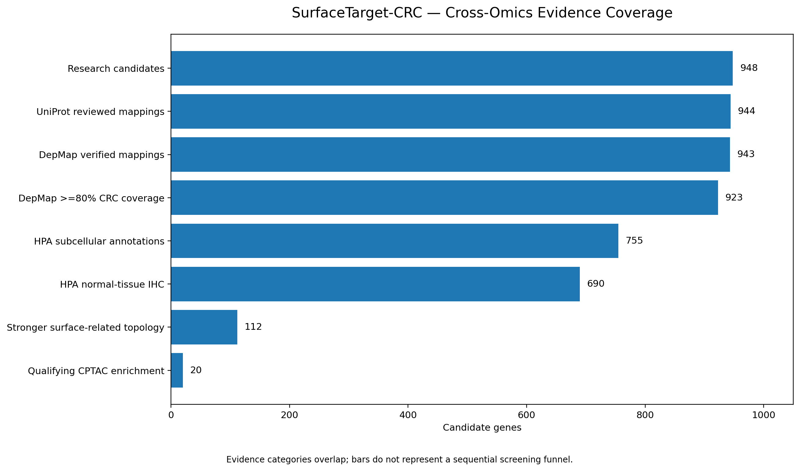
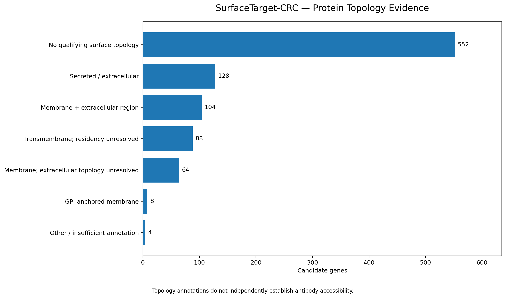
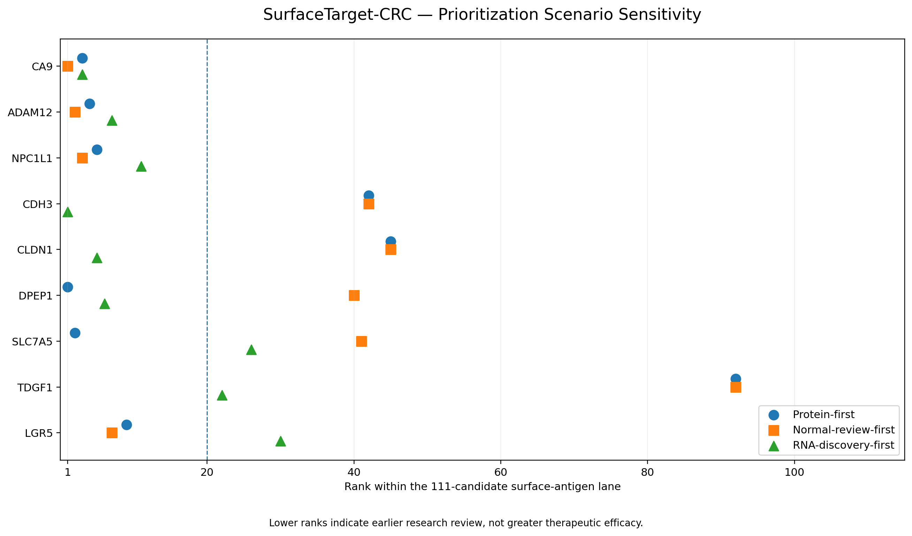

# SurfaceTarget-CRC
## Phase 6.1 — Evidence and Figure Audit

This document records validated research evidence used for the initial SurfaceTarget-CRC figures.

The analyses concern exploratory therapeutic targeting hypotheses. They do not demonstrate therapeutic efficacy or clinical safety.

## Candidate inventory

- Original candidate universe: 948 genes.
- Final research-review panel: 15 genes.
- Stronger surface-related annotations: 112 genes.
- Qualifying CPTAC protein enrichment: 20 genes.
- Normal-tissue HPA IHC annotations: 690 genes.
- Verified DepMap mappings: 943 genes.

## Figure 1 — Evidence coverage

Evidence availability varies substantially across molecular and protein-annotation resources.
These categories overlap and must not be presented as sequential candidate elimination stages.

## Figure 2 — Protein topology

The topology figure separates membrane-associated proteins, secreted proteins, and candidates without qualifying surface annotations.
These classifications are based on extracted biological annotations rather than direct antibody-binding assays.

## Figure 3 — Ranking sensitivity

The surface-antigen research panel was evaluated under three different research-priority scenarios.
Protein-first and normal-review-first ordering assumptions were highly correlated in the original analysis.
Cross-scenario agreement does not constitute independent biological validation.

## Three-scenario-consistent candidates

- ADAM12
- CA9
- NPC1L1

These three genes appeared in the top 20 of all three scenarios within the putative surface-antigen review lane.

This result reflects ranking consistency under the selected rules, not therapeutic superiority.

## Scope and limitations

The TCGA discovery workflow included computationally low-MSI samples that are not independently confirmed MSS cases.

The CPTAC enrichment analysis used an independent paired MSS colon cancer proteomic cohort.

The DepMap colorectal cell-line cohort has not been established as entirely MSS.

Bulk tumor RNA and proteomics cannot independently determine whether a signal originates from malignant epithelial cells or the tumor microenvironment.

Normal-tissue IHC findings are descriptive and do not predict clinical toxicity.

Protein topology annotations do not prove extracellular epitope accessibility or antibody internalization.

CRISPR gene-effect values describe cell fitness after gene knockout; they do not directly predict antibody-drug conjugate efficacy.

All 948 genes remain retained in the full research dataset.

No therapeutic target has been experimentally validated by this project.
